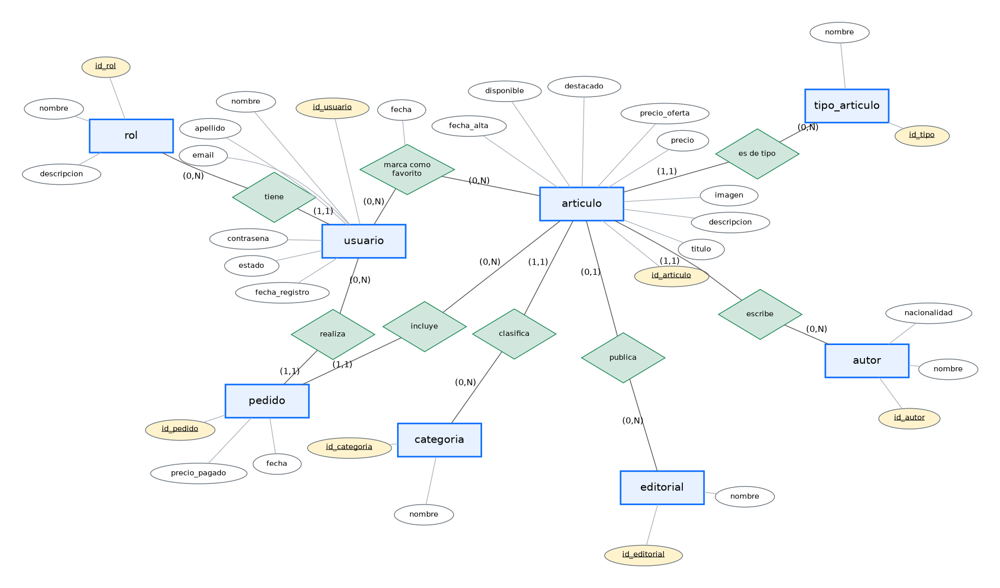
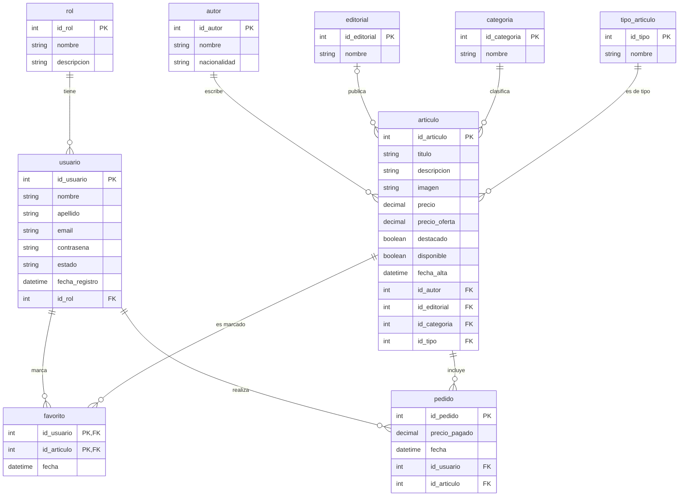

# Modelo Entidad-Relación (MER) — Biblionline

**Entidades:** `rol`, `usuario`, `autor`, `editorial`, `categoria`, `tipo_articulo`, `articulo`, `pedido`.
Las claves primarias están subrayadas (en amarillo en el diagrama).

## Relaciones y cardinalidades

| Relación | Entidad A | Entidad B | Cardinalidad | Explicación |
|---|---|---|---|---|
| tiene | rol (0,N) | usuario (1,1) | 1 : N | Un rol lo tienen muchos usuarios; cada usuario tiene exactamente un rol. |
| escribe | autor (0,N) | articulo (1,1) | 1 : N | Un autor escribe muchos artículos; cada artículo tiene un autor. |
| publica | editorial (0,N) | articulo (0,1) | 1 : N | Una editorial publica muchos artículos; un artículo puede no tener editorial. |
| clasifica | categoria (0,N) | articulo (1,1) | 1 : N | Una categoría agrupa muchos artículos; cada artículo tiene una categoría. |
| es de tipo | tipo_articulo (0,N) | articulo (1,1) | 1 : N | Libro / Revista / Audiolibro. |
| marca como favorito | usuario (0,N) | articulo (0,N) | N : M | Un usuario marca muchos favoritos y un artículo puede ser favorito de muchos usuarios. Atributo propio: `fecha`. Se resuelve con la tabla `favorito`. |
| realiza | usuario (0,N) | pedido (1,1) | 1 : N | Un usuario realiza muchos pedidos; cada pedido es de un solo usuario. |
| incluye | articulo (0,N) | pedido (1,1) | 1 : N | Un artículo puede estar en muchos pedidos; cada pedido es de un solo artículo. Un usuario no repite el mismo artículo (clave única). |

## Versión editable (Mermaid, GitHub la dibuja sola)

